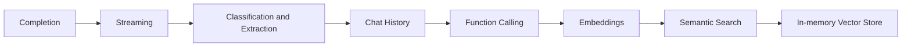

# .NET Generative AI Learning

تطبيقات تعليمية خطوة بخطوة باستخدام **.NET 10** و**Microsoft.Extensions.AI** و**Ollama محليًا**.

## مركز المذاكرة في Notion

[🤖 AI Transition & GenAI for .NET Study Hub](https://app.notion.com/p/AI-Transition-GenAI-for-NET-Study-Hub-3ee32897ce718106b839f0b097be7e02)

الـ Study Hub هو المرجع للمفاهيم والمراجعة وملاحظات الدروس، وهذا المستودع هو التطبيق العملي القابل للتشغيل. ترتيب المذاكرة في Notion هو **Course → Section → Lesson**، مع تمييز **Pre-study / Extra Notes** عن دروس الكورس.

الكورس الأساسي: **Develop Chat, Vector Search, VectorDB, RAG and EShop AI Apps using OpenAI, Ollama and Microsoft Extensions AI (MEAI)** — Mehmet Ozkaya. هذه التطبيقات تستخدم Ollama محليًا، وقد تختلف إعدادات المزوّد وإصدارات الحزم عن مثال المدرب.

| مرجع المذاكرة | علاقته بالكود هنا |
|---|---|
| [Section 1 — Introduction](https://app.notion.com/p/3ef32897ce7181fca65ac564d3481e2b) | خريطة الكورس والمشاريع |
| [Section 2 — GenAI Concepts](https://app.notion.com/p/3ef32897ce7181868c11e5441b09d32a) | LLM، Tokens، Context، Prompt Engineering |
| [.NET + AI Ecosystem](https://app.notion.com/p/3f632897ce7181be9516c4b637e2f4a7) | فهم العقود والتكاملات مثل IChatClient |
| [Section 4 — Setup LLM Providers](https://app.notion.com/p/3f732897ce7181bc8191ef7499d4da60) | إعداد Ollama؛ طريقة تشغيل النسخة المحلية موضحة أدناه |
| [Section 5 — Chat, Text Analysis and Function Calling](https://app.notion.com/p/3f832897ce7181da8990f059fa6b3c21) | `TextCompletion` و`FunctionCall`؛ و`ProductStock` تجربة إضافية لتثبيت الفكرة |
| [Section 6 — Vector Embeddings and Vector Store](https://app.notion.com/p/40332897ce71818d9cb3efa12a4a8909) | `section6_vectors/Embeddings` و`section6_vectors/VectorSearch` |

قد تتطلب صفحات Notion تسجيل الدخول أو صلاحية وصول. الشرح الأساسي وأوامر التشغيل موجودة هنا أيضًا، ولا يتطلب بناء المشاريع حساب Notion.

### طريقة الاستفادة من الاثنين

1. اقرأ المفهوم والدرس المقابل في Notion.
2. افتح المشروع واقرأ المثال النشط؛ أمثلة الدروس السابقة محفوظة في regions معلّقة عند وجودها.
3. شغّل المثال، وافحص مخرجاته أو استخدم breakpoint، ثم جرّب تغييرًا صغيرًا.
4. سجّل في Notion: ما فهمته، والنتيجة الفعلية، وما لم يتضح، والخطوة التالية.

**حدود التنفيذ الحالي:** قد تناقش الملاحظات Qdrant وChunking وRAG ومشاريع مستقبلية؛ وجودها في خريطة الدراسة لا يعني تنفيذها في هذا المستودع. مرجع الحالة العملية هو جدول المشاريع والكود الحالي، وليس قائمة الموضوعات المخططة.

## مراجعة سريعة للمشاريع

[Portfolio review guide — code navigation and implementation boundaries](docs/PORTFOLIO_GUIDE.md)

## المشاريع

| المشروع | الموضوع | التنفيذ الحالي |
|---|---|---|
| `TextCompletion` | Completion، Streaming، Classification، Summarization، Sentiment، Structured Output، Chat History | ChatApp هو المثال النشط؛ الأمثلة السابقة داخل regions معلّقة |
| `FunctionCall` | استدعاء دالة C# للطقس تلقائيًا | اختيار موديل وفحص tools؛ بيانات الطقس محاكاة |
| `ProductStock` | Function Calling للاستعلام عن مخزون منتج | Dictionary تجريبية؛ ليست قاعدة بيانات |
| `section6_vectors/Embeddings` | Embeddings وCosine Similarity وSemantic Search | ترتيب جمل حسب قربها من السؤال |
| `section6_vectors/VectorSearch` | تخزين وبحث المتجهات داخل الذاكرة | أفلام، Top-K، threshold تجريبي، وعزل إنشاء المولّد |

## المتطلبات

- .NET 10 SDK.
- Ollama يعمل على `http://localhost:11434/`، مباشرة أو داخل Docker.
- `llama3.2` للمحادثة وFunction Calling، و`all-minilm` للـ embeddings.
- Visual Studio يدعم .NET 10 أو أي محرر مع dotnet CLI.

النماذج ليست ضمن المستودع. لتنزيلها داخل حاوية اسمها `ollama` تعمل بالفعل:

```powershell
docker exec ollama ollama pull llama3.2
docker exec ollama ollama pull all-minilm
```

لو Ollama مثبت مباشرة على الجهاز، استخدم `ollama pull` دون `docker exec`.

## الاستعادة والبناء

من جذر المستودع:

```powershell
dotnet restore Solution1.slnx --source https://api.nuget.org/v3/index.json
dotnet build Solution1.slnx --no-restore
```

تحديد المصدر الرسمي مفيد إذا كانت إعدادات NuGet على الجهاز تحتوي مصادر خاصة غير متاحة. لا يغيّر إعدادات NuGet العامة.

## إعدادات التطوير المحلية

ملفات User Secrets خارج المستودع. وجود UserSecretsId في csproj لا ينقل القيم إلى جهاز جديد، والمعرف نفسه ليس كلمة مرور.

### TextCompletion

```powershell
dotnet user-secrets set "AI:Endpoint" "http://localhost:11434/v1" --project TextCompletion
dotnet user-secrets set "AI:ApiKey" "ollama" --project TextCompletion
dotnet user-secrets set "AI:ChatModel" "llama3.2:latest" --project TextCompletion
dotnet run --project TextCompletion
```

هذا المشروع يستخدم واجهة OpenAI-compatible المحلية. القيمة `ollama` شكلية وليست مفتاحًا سحابيًا. اختر الموديل من القائمة ثم اكتب رسائل المحادثة. يمكن إنهاء التشغيل بـ Ctrl+C.

### FunctionCall

```powershell
dotnet user-secrets set "AI:Endpoint" "http://localhost:11434/" --project FunctionCall
dotnet user-secrets set "AI:ChatModel" "llama3.2:latest" --project FunctionCall
dotnet run --project FunctionCall
```

يستخدم OllamaSharp الأصلي دون `/v1` ودون API key. اختر موديلًا يدعم الأدوات؛ نجاحنا العملي كان مع `llama3.2:latest`. إعلان tools وحده لا يضمن صحة سلوك كل نموذج. رسالة `[Tool invoked]` تثبت دخول دالة C#، وليس بالضرورة صحة كل مدخل أو النتيجة النهائية.

### بقية المشاريع

```powershell
dotnet run --project ProductStock
dotnet run --project section6_vectors/Embeddings
dotnet run --project section6_vectors/VectorSearch
```

## خريطة التعلّم



### Function Calling

```text
User Prompt → LLM selects tool + arguments → .NET executes function
→ Tool result → LLM final answer
```

التطبيق مسؤول عن تنفيذ الأدوات والتحقق والصلاحيات في الأنظمة الفعلية. النماذج قد تخطئ أو تتجاهل التعليمات. Structured Output يضبط بنية الاستجابة ولا يضمن صحة المعلومات.

### Vector Search

```text
Movie description → all-minilm → 384-dimensional vector → upsert
Query → same embedding model → Top-2 candidates → example threshold
```

- InMemoryVectorStore يخزن داخل ذاكرة العملية فقط؛ البيانات تزول عند انتهاء التشغيل.
- لا يوجد Qdrant أو RAG في المرحلة الحالية.
- درجات التشابه ليست احتمالات أو نسبًا مئوية.
- `0.20` حد تعليمي فقط؛ يحتاج تقييمًا قبل استخدامه في تطبيق فعلي.
- تغيير نموذج Embeddings يتطلب مراجعة الأبعاد وإعادة توليد متجهات البيانات وتقييم threshold.
- إنشاء المولّد معزول في `CreateEmbeddingGenerator()`، دون DI أو طبقات إضافية.

## ملاحظات التشغيل

- خطأ اتصال localhost: تحقق من تشغيل Ollama. مع Docker، افتح Docker Desktop وانتظر جاهزية المحرك قبل `docker start ollama`.
- خطأ 404 مع اسم موديل: تحقق من تنزيله داخل نفس Ollama الذي يتصل به التطبيق.
- واجهنا Windows Application Control عند التشغيل داخل OneDrive؛ نجح التشغيل من مسار تطوير محلي مثل `C:\Dev`، دون تغيير سياسات الأمان.
- عند تبديل الأمثلة، فعّل region المطلوبة فقط لتجنب إرسال طلبات متعددة دون قصد.

### حدود عزل المزوّد

`CreateEmbeddingGenerator()` تجمع عنوان Ollama واسم `all-minilm` وإنشاء `OllamaApiClient` في مكان واحد، بينما يستخدم indexing وretrieval واجهة `IEmbeddingGenerator<string, Embedding<float>>`. هذا ليس اختيارًا جاهزًا بين Cloud وLocal؛ التنفيذ الحالي يرجع Ollama دائمًا. كذلك إنشاء `InMemoryVectorStore` لا يزال مباشرًا في `Program.cs`، ولم يُضف موصل Qdrant.

قرار **توليد المتجهات** منفصل عن قرار **تخزينها والبحث فيها**. تغيير المزوّد قد يحافظ على شكل التدفق، لكنه يحتاج مراجعة توافق النموذج والأبعاد والبيانات والدرجات.

## مراجع التعلّم

- [شرح TextCompletion بالعربي](TEXT_COMPLETION_WALKTHROUGH.md): شرح تفصيلي للمرحلة الأولى؛ الكود الحالي تطور بعدها ليشمل اختيار الموديل والشات والأمثلة الإضافية.
- [Microsoft.Extensions.AI](https://learn.microsoft.com/dotnet/ai/microsoft-extensions-ai)
- [VectorData](https://learn.microsoft.com/semantic-kernel/concepts/vector-store-connectors/)
- [Ollama](https://docs.ollama.com/)

المستودع أمثلة تعليمية، وليس تطبيق إنتاج مكتملًا. الطقس والمخزون بيانات تجريبية، ولا توجد مفاتيح سحابية مطلوبة للأمثلة المحلية.
