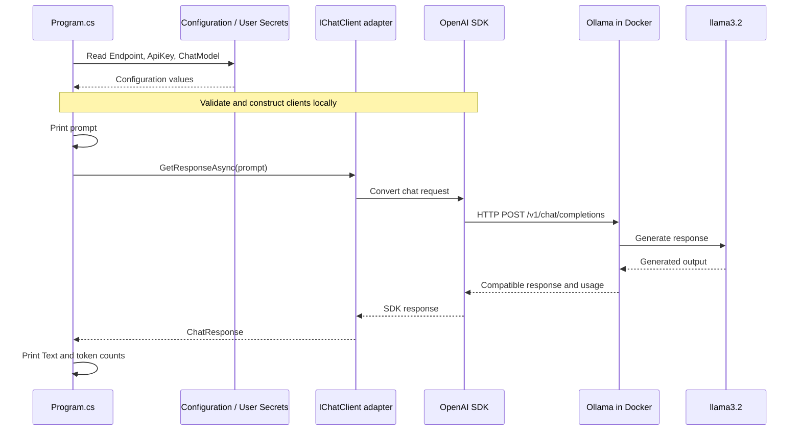

# دليل تعلّم TextCompletion: من Console App إلى نموذج محلي

هذا الدليل موجّه لمطوّر .NET Backend لديه خبرة في HTTP وواجهات C#، ويبدأ تعلّم Generative AI. يشرح العينة الموجودة فعليًا، دون إضافة أي تنفيذ جديد.

المسار الحالي: `C:\Dev\genai\Solution1`، والمشروع: `TextCompletion`، والإطار: `.NET 10`.

> أسماء الإعدادات الفعلية هي `AI:Endpoint` و`AI:ApiKey` و`AI:ChatModel`. تكرار كلمة AI وحدها لا يعني تخزين ثلاث قيم بالمفتاح نفسه؛ `AI` هو القسم، وما بعد النقطتين هو اسم الخاصية.

## المحتويات

1. نظرة عامة على المشروع
2. رحلة الطلب كاملة وترتيب التنفيذ الحقيقي
3. شرح كل سطر في Program.cs
4. كود المزوّد مقابل طبقة التجريد
5. كيف يحدث الاتصال بـ Ollama
6. مخططات المعمارية ودورة الطلب
7. حزم NuGet
8. User Secrets
9. Docker وOllama
10. فهم Tokens
11. تغيير النموذج
12. تغيير المزوّد مستقبلًا
13. المشكلات التي واجهناها
14. النموذج الذهني النهائي

## 1. نظرة عامة على المشروع

### ماذا يفعل؟

يقرأ التطبيق إعدادات الاتصال من User Secrets، وينشئ عميلًا محلي التوجيه، ثم يرسل سؤالًا واحدًا:

```text
What is AI? Explain in maximum 20 words.
```

بعد انتظار الرد، يطبع النص وإحصائيات التوكنز المتاحة. لا توجد محادثة متعددة الأدوار، ولا streaming، ولا loops، ولا RAG أو embeddings أو function calling.

اسم الدرس Text Completion، لكن التنفيذ يستخدم واجهة chat completion لإنتاج إجابة نصية لسؤال واحد. لا نستخدم واجهة OpenAI القديمة `/completions`.

### ما المشكلة التي يحلها؟

نريد تجربة استدعاء نموذج لغوي من .NET دون الاعتماد على GitHub Models أو خدمة سحابية. Ollama يشغّل النموذج محليًا، بينما يوفر `IChatClient` عقدًا موحّدًا للكود الذي يطلب الإجابة.

كمطوّر Backend، تخيّل نموذجًا خلف HTTP API: تطبيقك لا يحمّل أوزان النموذج داخل عملية .NET؛ بل يرسل طلبًا إلى خدمة inference. Inference هو استخدام نموذج جاهز لإنتاج نتيجة، وليس تدريبًا جديدًا للنموذج.

### المعمارية العامة

كل شيء داخل `Program.cs`: إعدادات، تحقق، إنشاء عميل، استدعاء واحد، عرض النتائج. لا حاجة في هذا المثال إلى DI أو HostBuilder أو Service Layer. الفصل الحالي منطقي عبر الواجهات، ولا يتطلب توزيع الكود على مشاريع إضافية.

## 2. رحلة الطلب كاملة وترتيب التنفيذ الحقيقي

### خريطة الفهم

```text
User Prompt
→ Program.cs
→ Configuration
→ User Secrets
→ OpenAI-compatible client
→ IChatClient
→ Ollama endpoint
→ llama3.2
→ model response
→ token usage
→ console output
```

الخريطة تربط المكونات التي يحتاجها السؤال حتى يصل إلى النموذج. لكنها ليست ترتيب السطور الزمني: البرنامج يقرأ الإعدادات وينشئ العميل قبل تعريف السؤال. كذلك User Secrets هي مصدر Configuration، وIChatClient هو الواجهة التي يستخدمها كود الطلب فوق عميل المزوّد.

### الترتيب الزمني الدقيق في العينة

1. يبدأ تنفيذ top-level statements في `Program.cs`.
2. يبني Configuration ويضيف مصدر User Secrets.
3. يقرأ العنوان والمفتاح واسم النموذج.
4. يتحقق من عدم غياب أي قيمة.
5. يطبع Endpoint وChatModel، دون المفتاح.
6. ينشئ OpenAIClient ويوجهه إلى عنوان Ollama.
7. ينشئ ChatClient للنموذج ثم يقدمه كـ IChatClient.
8. يطبع رسالة نجاح إنشاء العميل؛ هذه لا تثبت نجاح الاتصال بعد.
9. يعرّف prompt ويطبعه.
10. يستدعي `GetResponseAsync` مرة واحدة وينتظر الرد.
11. يطبع `response.Text`.
12. يطبع input/output/total tokens، أو رسالة عدم التوفر لكل قيمة غائبة.
13. عند الخروج من النطاق، يجري التخلص من موارد `chatClient` بسبب `using` declaration.

الـ prompt ليس مدخلًا تفاعليًا من `Console.ReadLine` هنا؛ هو نص ثابت داخل المثال. كذلك لا توجد عملية قراءة جديدة من User Secrets عند كل token أو أثناء توليد الإجابة.

## 3. شرح كل سطر في Program.cs

### الكود الكامل الحالي

```csharp
using Microsoft.Extensions.AI;
using Microsoft.Extensions.Configuration;
using OpenAI;
using System.ClientModel;

var configuration = new ConfigurationBuilder()
    .AddUserSecrets<Program>()
    .Build();

var endpoint = configuration["AI:Endpoint"];
var apiKey = configuration["AI:ApiKey"];
var chatModel = configuration["AI:ChatModel"];

if (string.IsNullOrWhiteSpace(endpoint))
    throw new InvalidOperationException("Missing required setting: AI:Endpoint");

if (string.IsNullOrWhiteSpace(apiKey))
    throw new InvalidOperationException("Missing required setting: AI:ApiKey");

if (string.IsNullOrWhiteSpace(chatModel))
    throw new InvalidOperationException("Missing required setting: AI:ChatModel");

Console.WriteLine($"Endpoint: {endpoint}");
Console.WriteLine($"ChatModel: {chatModel}");

var openAIClient = new OpenAIClient(
    new ApiKeyCredential(apiKey),
    new OpenAIClientOptions { Endpoint = new Uri(endpoint) });

using IChatClient chatClient = openAIClient
    .GetChatClient(chatModel)
    .AsIChatClient();

Console.WriteLine("IChatClient created successfully.");

var prompt = "What is AI? Explain in maximum 20 words.";
Console.WriteLine($"User: {prompt}");

var response = await chatClient.GetResponseAsync(prompt);
Console.WriteLine($"Model: {response.Text}");

Console.WriteLine($"Input tokens: {response.Usage?.InputTokenCount?.ToString() ?? "Not available from this provider/client."}");
Console.WriteLine($"Output tokens: {response.Usage?.OutputTokenCount?.ToString() ?? "Not available from this provider/client."}");
Console.WriteLine($"Total tokens: {response.Usage?.TotalTokenCount?.ToString() ?? "Not available from this provider/client."}");
```

الأسطر الفارغة في الملف تفصل مراحل القراءة بصريًا، وليس لها سلوك تنفيذي. الكتلة أعلاه تحافظ على ترتيب التعليمات، مع اختصار الفراغات الزائدة فقط.

### أ. using statements

| السطر | ماذا يتيح؟ |
|---|---|
| `using Microsoft.Extensions.AI;` | استخدام `IChatClient` وامتدادات مثل `AsIChatClient` ونداء النص البسيط لـ `GetResponseAsync`. |
| `using Microsoft.Extensions.Configuration;` | استخدام `ConfigurationBuilder` وامتداد `AddUserSecrets`. |
| `using OpenAI;` | استخدام `OpenAIClient` و`OpenAIClientOptions` من SDK الخاص ببروتوكول OpenAI. |
| `using System.ClientModel;` | استخدام `ApiKeyCredential` لتمرير بيانات اعتماد العميل. |

هذه using directives تستورد namespaces وقت الترجمة؛ لا تنشئ اتصالًا ولا تثبت حزمًا. اسم حزمة NuGet ليس بالضرورة اسم namespace. لذلك لا نكتب `using Microsoft.Extensions.AI.OpenAI;` لمجرد أن هذا اسم الحزمة؛ امتدادها المستخدم هنا متاح تحت `Microsoft.Extensions.AI`.

### ب. بناء Configuration

```csharp
var configuration = new ConfigurationBuilder()
    .AddUserSecrets<Program>()
    .Build();
```

- `var configuration =` يعرّف متغيرًا بنوع يستنتجه المترجم؛ ليس dynamic.
- `new ConfigurationBuilder()` ينشئ builder لتجميع مصادر الإعدادات. يشبه تجهيز قائمة configuration providers قبل قراءة connection string.
- `.AddUserSecrets<Program>()` يستخدم assembly الذي يحتوي على `Program` للعثور على `UserSecretsId`، ثم يضيف مصدر User Secrets المرتبط به. في هذا الـ overload المصدر اختياري افتراضيًا؛ غياب ملف الأسرار لا يغني عن التحقق من المفاتيح المطلوبة.
- `Program` هنا هو النوع الذي يولده المترجم لـ top-level statements؛ لم نحتج إلى كتابة class Program يدويًا.
- `.Build()` يبني كائن Configuration قابلًا للقراءة ويحمّل بيانات المصادر المضافة. لا يتصل بـ Ollama.

البرنامج يضيف User Secrets فقط. لا تضف له افتراضات إعدادات ASP.NET Core الافتراضية: هنا لا يوجد HostBuilder يقرأ appsettings أو environment variables تلقائيًا.

### ج. قراءة الإعدادات الثلاثة

```csharp
var endpoint = configuration["AI:Endpoint"];
var apiKey = configuration["AI:ApiKey"];
var chatModel = configuration["AI:ChatModel"];
```

كل سطر يستخدم indexer على Configuration لاسترجاع string. إذا لم يوجد المفتاح تكون النتيجة null.

| المفتاح | القيمة الحالية | المعنى |
|---|---|---|
| `AI:Endpoint` | `http://localhost:11434/v1` | العنوان الأساسي لخدمة API المتوافقة مع OpenAI. |
| `AI:ApiKey` | `ollama` | قيمة شكلية مطلوبة لإنشاء عميل SDK، يتجاهلها Ollama المحلي. |
| `AI:ChatModel` | `llama3.2` | اسم النموذج الذي سيطلبه العميل من السيرفر. |

النقطتان `:` تعبّران عن مسار إعداد هرمي: قسم AI وداخله Endpoint أو ApiKey أو ChatModel. لا نستخدم `AI:Model` أو `AI:ModelId` في هذا المشروع.

### د. التحقق من القيم

```csharp
if (string.IsNullOrWhiteSpace(endpoint))
    throw new InvalidOperationException("Missing required setting: AI:Endpoint");
```

`IsNullOrWhiteSpace` يعيد true إذا كانت القيمة null أو فارغة أو مسافات فقط. السطر التالي يرمي استثناءً وينهي التنفيذ قبل إنشاء العميل إذا كان الإعداد غير صالح بهذه الصورة. عدم وجود أقواس يعني أن التعليمة التالية فقط تابعة للـ if.

```csharp
if (string.IsNullOrWhiteSpace(apiKey))
    throw new InvalidOperationException("Missing required setting: AI:ApiKey");
```

نفس النمط للمفتاح. الرسالة تعرض اسم الإعداد الناقص، لا قيمته، فلا تكشف مفتاحًا حقيقيًا لو تغيّر المزوّد لاحقًا.

```csharp
if (string.IsNullOrWhiteSpace(chatModel))
    throw new InvalidOperationException("Missing required setting: AI:ChatModel");
```

نفس النمط لاسم النموذج. هذا Fail Fast مألوف في Backend: اكتشف نقص الإعدادات قبل طلب خارجي يصعب تفسير خطئه.

هذا التحقق لا يختبر وجود الموديل لدى Ollama ولا صلاحية الشبكة. كذلك عدم فراغ endpoint لا يضمن أنه URI صالح؛ `new Uri(endpoint)` يتولى تحليل العنوان لاحقًا.

### هـ. طباعة إعدادات آمنة للتحقق

```csharp
Console.WriteLine($"Endpoint: {endpoint}");
Console.WriteLine($"ChatModel: {chatModel}");
```

كل سطر يستخدم string interpolation لإدراج قيمة داخل النص. نطبع الوجهة والنموذج لمعرفة ما الذي سنستدعيه. لا يوجد سطر لطباعة apiKey.

### و. إنشاء عميل المزوّد

```csharp
var openAIClient = new OpenAIClient(
    new ApiKeyCredential(apiKey),
    new OpenAIClientOptions { Endpoint = new Uri(endpoint) });
```

- `var openAIClient = new OpenAIClient(` يبدأ إنشاء SDK client. تشبيه Backend: typed HTTP client مهيأ لبروتوكول معيّن.
- `new ApiKeyCredential(apiKey),` ينشئ كائن بيانات اعتماد من الإعداد الموجود. هو لا يصدر API key جديدًا، ولا يتحقق الآن من صحته عند السيرفر.
- `new OpenAIClientOptions { ... }` ينشئ options باستخدام object initializer.
- `Endpoint = new Uri(endpoint)` يحدد base address. لذلك الطلب يذهب إلى localhost بدل العنوان الافتراضي لخدمة OpenAI السحابية.
- `);` ينهي الاستدعاء الذي تلقى credential وoptions.

إنشاء هذا الكائن لا يحمّل llama3.2 ولا يرسل السؤال. نجاح الإنشاء يعني أن كائن العميل جاهز محليًا، وليس أن الخدمة الخارجية سليمة.

### ز. الحصول على ChatClient وتقديمه كواجهة

```csharp
using IChatClient chatClient = openAIClient
    .GetChatClient(chatModel)
    .AsIChatClient();
```

- `using IChatClient chatClient = openAIClient` يعلن متغيرًا نوعه الواجهة المشتركة، مع التخلص من موارده عند نهاية النطاق. هذه using declaration مختلفة عن using directives أول الملف.
- `.GetChatClient(chatModel)` يحصل على عميل chat مضبوط على اسم النموذج. لا يبحث عن قائمة النماذج ولا يثبّت النموذج؛ يجهز اسم النموذج للطلبات اللاحقة.
- `.AsIChatClient()` يغلّف عميل OpenAI بمحوّل Adapter تقدمه حزمة Microsoft.Extensions.AI.OpenAI.

المحوّل يترجم أنواع الطلبات والردود بين الواجهة العامة وأنواع SDK. النوع المعلن IChatClient يجعل بقية المثال تعتمد على contract معروف بدل تفاصيل OpenAI.Chat.ChatClient. يشبه اعتماد منطق الدفع على IPaymentGateway بينما يوجد adapter خاص بمزوّد الدفع.

```csharp
Console.WriteLine("IChatClient created successfully.");
```

رسالة تشخيصية بعد الإنشاء، لا health check للشبكة.

### ح. السؤال والاستدعاء

```csharp
var prompt = "What is AI? Explain in maximum 20 words.";
Console.WriteLine($"User: {prompt}");
```

الأول يحفظ السؤال والثاني يطبعه قبل الطلب. قيد 20 كلمة تعليمة بلغة طبيعية للنموذج؛ ليس validation أو حدًا برمجيًا مضمونًا. لا يوجد كود يعد الكلمات أو يقتطع الإجابة.

```csharp
var response = await chatClient.GetResponseAsync(prompt);
```

- `GetResponseAsync(prompt)` يستخدم امتدادًا مناسبًا للنص البسيط فوق واجهة IChatClient، ويحوّل النص إلى مدخل محادثة للمحوّل.
- `await` ينتظر العملية غير المتزامنة دون استعمال `.Result` أو حجز الخيط بالانتظار المتزامن.
- ينتج `ChatResponse` يحتوي النص وبيانات إضافية ومنها Usage إن توفرت.
- لا توجد streaming في هذا المثال؛ الكود التالي يعمل بعد وصول الرد الكامل.
- يوجد استدعاء واحد في كودنا. سياسة SDK قد تعيد محاولة النقل عند بعض الأخطاء، وهذا يختلف عن إضافة loop في البرنامج.

```csharp
Console.WriteLine($"Model: {response.Text}");
```

`response.Text` يمثل المحتوى النصي الذي تعرضه الاستجابة المشتركة. لا يعني الاسم أن الرد هو كائن model نفسه؛ إنه ناتج النموذج. الرد ليس مضمون الصحة أو ثابتًا بين تشغيل وآخر.

### ط. طباعة Usage سطرًا بسطر

```csharp
Console.WriteLine($"Input tokens: {response.Usage?.InputTokenCount?.ToString() ?? "Not available from this provider/client."}");
```

`response.Usage` يحتوي usage metadata إذا نقلها المزوّد والمحوّل. `?.` يتوقف بأمان عند null. `InputTokenCount` عدد توكنز المدخل المبلّغ عنه. `?.ToString()` يحوّل العدد المتاح إلى نص، و`??` يختار الرسالة البديلة فقط إذا كانت النتيجة null. العدد صفر قيمة حقيقية ولا يستبدل بالرسالة.

```csharp
Console.WriteLine($"Output tokens: {response.Usage?.OutputTokenCount?.ToString() ?? "Not available from this provider/client."}");
```

نفس الأسلوب لعدد التوكنز الناتجة، دون حساب تقديري اعتمادًا على طول النص.

```csharp
Console.WriteLine($"Total tokens: {response.Usage?.TotalTokenCount?.ToString() ?? "Not available from this provider/client."}");
```

نطبع الإجمالي الذي تعرضه الاستجابة. لا يجمع التطبيق العددين بنفسه إذا كان الإجمالي غائبًا. هذه الدقة مفيدة لأن اكتمال بيانات usage قد يختلف بين المزوّدين.

## 4. كود المزوّد مقابل طبقة التجريد

| الجزء | موقعه في الفصل | السبب |
|---|---|---|
| `OpenAIClient` | خاص بتقنية SDK | يعرف شكل بروتوكول OpenAI. |
| `OpenAIClientOptions.Endpoint` | إعداد عميل المزوّد | يختار السيرفر الذي يستقبل HTTP. مفهوم endpoint عام، لكن الخاصية هنا من SDK. |
| `ApiKeyCredential` | إعداد المصادقة للعميل | يمرر بيانات الاعتماد وفق مسار SDK. |
| `GetChatClient(chatModel)` | إنشاء عميل خاص بالبروتوكول | يرجع ChatClient مرتبطًا بالنموذج. |
| `AsIChatClient()` | حد التحويل | يكيّف SDK إلى الواجهة المشتركة. |
| `IChatClient` | abstraction | عقد تستخدمه بقية العينة. |
| `GetResponseAsync` | استهلاك abstraction | يطلب ردًا دون ربط كود السؤال بأنواع OpenAI. |
| `ChatResponse.Text` و`Usage` | أنواع استجابة مشتركة | يسهّلان عرض النتائج بغض النظر عن التفاصيل الداخلية للمزوّد. |

الفائدة هي حصر التغيير عند construction boundary. تغيير مزوّد الدفع عادة يغيّر الـ adapter والمصادقة، مع بقاء تدفق الاستخدام؛ نفس الفكرة هنا. لكن abstraction لا تضمن تساوي قدرات النماذج، ولا أن جميع بيانات usage أو الخيارات متوفرة لدى كل مزوّد.

## 5. كيف يحدث الاتصال بـ Ollama؟

بحسب بيئة التشغيل التي وصفتها، Ollama يعمل في Docker، والمنفذ 11434 منشور إلى Windows. شرح هذا الجزء يفترض تلك البيئة؛ لم نُعد فحص إعدادات Docker أثناء كتابة الدليل.

1. يمرر البرنامج `http://localhost:11434/v1` كـ Endpoint.
2. عند `GetResponseAsync` يصل الطلب عبر adapter إلى OpenAI ChatClient.
3. يبني SDK طلب HTTP إلى واجهة chat completions على السيرفر المحلي.
4. Docker يمرر الاتصال من منفذ Windows إلى منفذ Ollama داخل الحاوية.
5. Ollama يفسر صيغة الطلب، ويختار النموذج المحدد باسم `llama3.2`.
6. محرك inference يولّد النص باستخدام موارد الجهاز المتاحة. قد يستغرق أول طلب وقتًا لتحميل النموذج.
7. يعيد Ollama الرد بصيغة متوافقة مع OpenAI.
8. SDK يقرأ الرد، ثم يحوّله adapter إلى ChatResponse.
9. يقرأ التطبيق Text وUsage ويطبعهما.

SDK هو مكتبة عميل، وليس دليلًا على أن البيانات تُرسل إلى OpenAI cloud. الوجهة الفعلية هنا يحددها Endpoint. Ollama يدعم جزءًا من واجهات OpenAI؛ لا تفترض أن كل ميزة سحابية متاحة محليًا. [توثيق التوافق](https://docs.ollama.com/api/openai-compatibility)

شكل HTTP التالي توضيحي، وليس تسجيل شبكة حرفيًا للطلب الذي نفذناه:

```http
POST http://localhost:11434/v1/chat/completions
Content-Type: application/json

{
  "model": "llama3.2",
  "messages": [
    { "role": "user", "content": "What is AI? Explain in maximum 20 words." }
  ]
}
```

التفاصيل الإضافية وheaders يتولاها SDK. الكود لا يستخدم مسار Ollama الأصلي `/api/chat`؛ يستخدم الواجهة المتوافقة تحت `/v1`.

## 6. مخططات المعمارية ودورة الطلب

### معمارية التطبيق

```mermaid
flowchart LR
    Secrets[User Secrets] --> Config[ConfigurationBuilder]
    Config --> Program[Program.cs - .NET 10]
    Program --> Interface[IChatClient]
    Interface --> Adapter[Microsoft.Extensions.AI.OpenAI Adapter]
    Adapter --> SDK[OpenAI ChatClient]
    SDK -->|HTTP localhost:11434/v1| Port[Windows published port 11434]
    Port --> Ollama[Ollama server in Docker]
    Ollama --> Model[llama3.2]
```



السهم بين الواجهة والـ adapter يوضح من ينفذ العقد؛ ليس خدمة شبكة مستقلة. Config يغذي إنشاء العميل أيضًا، وإن اختصر الرسم تفاصيل construction.

### دورة الطلب



## 7. حزم NuGet

| الحزمة المباشرة | الإصدار المثبت | دورها في المشروع |
|---|---|---|
| `Microsoft.Extensions.AI` | `10.11.0` | يجلب أدوات AI العامة ويعتمد على Abstractions التي تعرف IChatClient وChatResponse. لا نستخدم هنا ميزاته الإضافية مثل caching. |
| `Microsoft.Extensions.AI.OpenAI` | `10.11.0` | يوفر adapter وAsIChatClient، ويجلب SDK وتبعياته اللازمة. |
| `Microsoft.Extensions.Configuration` | `10.0.13` | بناء Configuration وقراءة المفاتيح. |
| `Microsoft.Extensions.Configuration.UserSecrets` | `10.0.13` | إضافة User Secrets كمصدر إعدادات. |

اختلاف أرقام إصدارات AI وConfiguration طبيعي؛ ليست كل الحزم تصدر بالجدول نفسه. المشروع الحالي net10.0 وقد نجح بناؤه بهذه الإصدارات.

الواجهة IChatClient موجودة تحديدًا في الحزمة التابعة `Microsoft.Extensions.AI.Abstractions`؛ وجودها لدينا يأتي عبر التبعيات. [مرجع Microsoft للحزم](https://learn.microsoft.com/en-us/dotnet/ai/microsoft-extensions-ai)

## 8. User Secrets

### لماذا خارج الكود؟

نفصل إعدادات المطوّر عن المصدر حتى لا نضع مفاتيح حقيقية مستقبلًا في Git. تعديل الإعدادات لا يتطلب إعادة كتابة منطق السؤال. Endpoint وChatModel ليسا أسرارًا بالضرورة، لكن وضع الثلاثة في المصدر نفسه يبقي الدرس بسيطًا.

User Secrets وسيلة تطوير محلية؛ ليست خزنة مشفرة للإنتاج. على Windows تكون البيانات عادة تحت ملف المستخدم في `%APPDATA%\Microsoft\UserSecrets\<UserSecretsId>\secrets.json`. لا نعتمد على قراءة هذا المسار يدويًا داخل البرنامج. [مرجع User Secrets](https://learn.microsoft.com/en-us/aspnet/core/security/app-secrets?view=aspnetcore-10.0)

### ما دور UserSecretsId؟

في csproj لدينا:

```xml
<UserSecretsId>f72559e4-4380-4f1e-817c-c153e5aaca43</UserSecretsId>
```

هو معرف يربط المشروع بمخزن محلي لحساب Windows، وليس كلمة مرور. نقله مع المشروع إلى C:\Dev أبقى الارتباط نفسه. هذا يفسر لماذا لم نحتج إلى إعادة حفظ الأسرار. على جهاز أو مستخدم مختلف، المعرف وحده لا ينقل القيم.

القيم الفعلية:

```text
AI:Endpoint = http://localhost:11434/v1
AI:ApiKey = ollama
AI:ChatModel = llama3.2
```

### لماذا المفتاح ollama؟

إنشاء OpenAI client بهذا المسار يتطلب credential بقيمة غير فارغة، بينما Ollama المحلي يتجاهل قيمة API key. لذلك `ollama` placeholder لتلبية عقد العميل، وليس مصادقة محلية حقيقية. هذا موثق في [أمثلة Ollama المحلية](https://docs.ollama.com/api/openai-compatibility).

لا تنطبق هذه الفكرة تلقائيًا على OpenAI cloud أو Ollama cloud؛ تلك البيئات قد تتطلب بيانات اعتماد حقيقية. البرنامج الحالي لا يطبع المفتاح.

## 9. Docker وOllama

```text
Windows
→ Docker Desktop
→ Ollama container
→ Ollama server
→ llama3.2 model
```

- Windows يشغّل تطبيق .NET وبيئة التطوير.
- Docker Desktop يدير تشغيل حاوية Ollama؛ في نمط Linux containers يعمل ذلك عبر بيئة Linux مدارة، مثل WSL2 بحسب إعداد الجهاز.
- الحاوية هي بيئة تشغيل الخدمة واعتمادياتها، وليست النموذج نفسه.
- Ollama server يقدم HTTP API ويدير تشغيل النماذج.
- llama3.2 هو النموذج: الأوزان وسلوك التوليد الذي يستخدمه runtime.

نشر المنفذ بصيغة `11434:11434` يعني ربط منفذ host على Windows بمنفذ الخدمة داخل الحاوية. ظهور المنفذ في Dockerfile وحده ليس بديلًا عن نشره. هذا النمط موجود في [توثيق Ollama Docker](https://docs.ollama.com/docker).

بالنسبة لتطبيقنا الذي يعمل على Windows، localhost يعني Windows، ثم تنقل آلية نشر المنفذ الاتصال للحاوية. لو نُقل تطبيق .NET نفسه إلى حاوية أخرى، فـ localhost سيشير إلى تلك الحاوية، ولن نفترض أن العنوان نفسه مناسب. هذه ملاحظة لفهم الشبكة فقط؛ لا نغيّر بنية العينة.

## 10. فهم Tokens

### ما هو token؟

هو وحدة من النص وفق tokenizer الخاص بالنموذج. قد يكون جزء كلمة أو كلمة أو علامة أو مجموعة رموز. تقسيم العربية والإنجليزية والأرقام والكود يختلف؛ لا توجد قاعدة ثابتة أن كل كلمة تساوي token واحدًا.

| الحقل | معناه |
|---|---|
| InputTokenCount | عدد وحدات المدخل التي يبلّغ عنها المزوّد؛ قد تشمل تمثيل الرسالة والقالب، وليس كلمات السؤال فقط. |
| OutputTokenCount | وحدات النص المولّد بحسب عدّ المزوّد. |
| TotalTokenCount | الإجمالي الذي تعرضه Usage؛ في تشغيلنا كان مجموع المدخل والمخرج. |

إذن طلب 20 كلمة لا يعني 20 output tokens، ولا يضمن أن النموذج يلتزم بعدد الكلمات. لا يوجد MaxOutputTokens مضبوط في هذا المثال.

### لماذا تهم مطوّر Backend؟

- **التكلفة:** خدمات سحابية كثيرة تحاسب على input/output tokens بمعدلات قد تختلف. التشغيل المحلي لا يحوّل هذه الأعداد إلى فاتورة API تلقائيًا، لكنه يستهلك موارد الجهاز.
- **الحدود:** قد توجد حدود tokens لكل طلب أو لكل فترة زمنية حسب المزوّد.
- **الزمن:** إنتاج نص أطول غالبًا يزيد زمن التوليد، لكن العتاد وحجم النموذج وتحميله تؤثر أيضًا.
- **السياق:** نافذة السياق هي سعة النموذج للتعامل مع المدخل والمخرجات وفق قيوده؛ ليست ذاكرة دائمة للتطبيق.

البرنامج يثق في الأرقام التي رجعت من المسار الحالي؛ لا يستخدم `Split` لعد الكلمات كتقدير للتوكنز. عدم توفر Usage لا يعني صفر استهلاك. لهذا توجد رسالة fallback لكل حقل.

مثال فعلي من تشغيل المستخدم:

```text
Input tokens: 36
Output tokens: 25
Total tokens: 61
```

الأرقام والنص قد تختلف في تشغيل لاحق. مثال اليوم نجح بطلب واحد؛ لا نرسل محادثة سابقة ولا نخزن history.

## 11. ماذا يحدث لو غيّرنا النموذج؟

المفتاح الصحيح الذي نغيّره هو `AI:ChatModel`:

```text
AI:ChatModel = llama3.2
```

يمكن مفاهيميًا تغييره إلى نموذج آخر متاح لدى نفس خادم Ollama، مثل:

```text
AI:ChatModel = gemma3:12b
```

هذا مثال تعليمي فقط؛ لم نغيّر الإعداد أو نثبّت أي نموذج أثناء كتابة الدليل. يلزم أن يكون الاسم متاحًا لدى السيرفر، وأن تسمح موارد الجهاز بتشغيله.

في التشغيل التالي يقرأ البرنامج الاسم الجديد، ويمرره إلى GetChatClient. يبقى كود prompt وGetResponseAsync وعرض النتائج كما هو. قد تتغير جودة الرد واللغة والسرعة واستهلاك الذاكرة والتوكنز. لا يضمن contract واحد سلوكًا لغويًا متطابقًا بين النماذج.

## 12. ماذا لو غيّرنا المزوّد لاحقًا؟

نريد الاحتفاظ بتدفق الاستخدام:

```csharp
var response = await chatClient.GetResponseAsync(prompt);
Console.WriteLine($"Model: {response.Text}");
```

في خدمة متوافقة مع OpenAI قد تتغير إعدادات Endpoint وcredential واسم النموذج. الانتقال إلى OpenAI cloud يتطلب إعدادات ومفتاحًا حقيقيًا؛ لا نترك قيمة ollama الشكلية.

بالنسبة إلى Azure، قد تختلف طريقة بناء العميل والمصادقة وتسمية deployment ودعم API؛ نستخدم العميل أو adapter المناسب ونعرضه أيضًا كـ IChatClient. الانتقال ليس وعدًا بأن تبديل URL يكفي دائمًا.

هذا قريب من Dependency Inversion في Backend: consumer يعتمد على العقد، وcomposition code يعرف التنفيذ. لا يتطلب هذا المثال إضافة DI لتحقيق الفكرة. ولم ننفذ أي انتقال فعلي إلى مزوّد آخر.

## 13. المشكلات التي واجهناها

### أ. Codex sandbox وSocketException 10013

ظهر عند محاولة الوصول إلى localhost من بيئة تنفيذ مقيّدة:

```text
An attempt was made to access a socket in a way forbidden by its access permissions.
System.Net.Sockets.SocketException (10013)
```

السبب المثبت في هذه الجلسة كان تقييد الاتصال من بيئة التنفيذ؛ نفس البرنامج نجح عند تشغيله خارج العزل بالإذن المناسب. لا تستنتج أن كل 10013 سببه Codex في أي جهاز؛ هو خطأ صلاحيات socket قد تكون له أسباب أخرى.

رأينا أيضًا `Retry failed after 4 tries`: كانت retries داخل SDK، وليست loop أضفناها إلى كود الدرس. لم نحتج إلى تغيير prompt أو endpoint لإصلاح مشكلة العزل.

### ب. Windows Application Control ومنع DLL

عند التشغيل من المسار القديم:

```text
C:\Users\ramad\OneDrive\Desktop\learning\genai\Solution1\TextCompletion\bin\Debug\net10.0\TextCompletion.dll
```

ظهر:

```text
System.IO.FileLoadException
An Application Control policy has blocked this file. (0x800711C7)
```

هذا فشل في تحميل assembly، أي قبل إرسال أي طلب AI. لا يعالجه تغيير model أو API key. لا نعرف من الرسالة وحدها قاعدة Windows التفصيلية التي منعت الملف، ولا نعمم أن كل ملفات OneDrive ممنوعة.

### ج. نسخ المشروع إلى C:\Dev

نُسخ الحل إلى:

```text
C:\Dev\genai\Solution1
├── Solution1.slnx
└── TextCompletion
    ├── TextCompletion.csproj
    └── Program.cs
```

احتفظنا بالأصل، واستبعدنا bin وobj و.vs لتُولد من جديد. تمت مقارنة hashes للكود وcsproj، فكانت مطابقة. ظل UserSecretsId كما هو، وعملت القيم الثلاث من المسار الجديد.

نجح restore وbuild بصفر أخطاء وتحذيرات، ثم نجح run. بعد ذلك كانت Visual Studio لا تزال تفتح الحل القديم، فتم إغلاق جلستها القديمة بشكل عادي وفتح الحل من C:\Dev. أكد تشغيل المستخدم أن المسار الجديد انتهى بـ exit code 0.

هذه معالجة ناجحة للحالة التي واجهناها، وليست ضمانًا عامًا بأن أي مسار C:\Dev يتجاوز سياسات الجهاز.

### د. التحقق المستقل من Ollama وHTTP 200

وفق سجل المشكلة الذي طلبت توثيقه، جرى التحقق من Ollama بصورة منفصلة وكانت النتيجة HTTP 200. لا يتضمن سجل الأدوات الظاهر هنا تفاصيل ذلك الفحص المستقل أو مساره، لذلك لا ننسب إليه response body أو اختبارًا محددًا لم نوثقه.

الذي تحققنا منه مباشرة في الجلسة هو نجاح طلب النموذج من التطبيق وعودة نص وUsage، ثم تأكيدك التشغيل من Visual Studio. هذه أدلة أقوى على نجاح المسار الكامل من مجرد HTTP 200 لعنوان آخر؛ فـ 200 من health endpoint وحده لا يثبت وجود llama3.2 أو نجاح التوليد.

### هـ. NuGet الخاص

واجه التثبيت مصدر Azure Artifacts خاصًا يرجع 401، لذلك استُخدم nuget.org صراحة عند تثبيت الحزم والاستعادة. لم نغيّر إعدادات مصادر NuGet العامة. هذا خطأ مصدر حزم منفصل عن الاتصال بـ Ollama.

## 14. النموذج الذهني النهائي

```text
Configuration
→ Provider Client
→ IChatClient
→ Prompt
→ Ollama
→ Model
→ Response
→ Usage
```

- Configuration تقول: أين الخدمة؟ وما النموذج؟ وما بيانات الاعتماد؟
- Provider Client يعرف HTTP والبروتوكول الخاص بالمزوّد.
- IChatClient هو العقد الذي يستخدمه كودك لطلب الرد.
- Prompt هو المدخل اللغوي، وليس برنامجًا حتمي النتائج.
- Ollama هو السيرفر، وllama3.2 هو النموذج الذي ينفذ التوليد.
- Response يحمل الناتج، وUsage تصف الاستهلاك المتاح.

كمطوّر Backend: أنت تنسّق استدعاء خدمة HTTP ذات ناتج مولّد. حافظ على وضوح الإعدادات وحدود المزوّد، وافصل نجاح إنشاء الكائن عن نجاح الاتصال وعن صحة إجابة النموذج.
