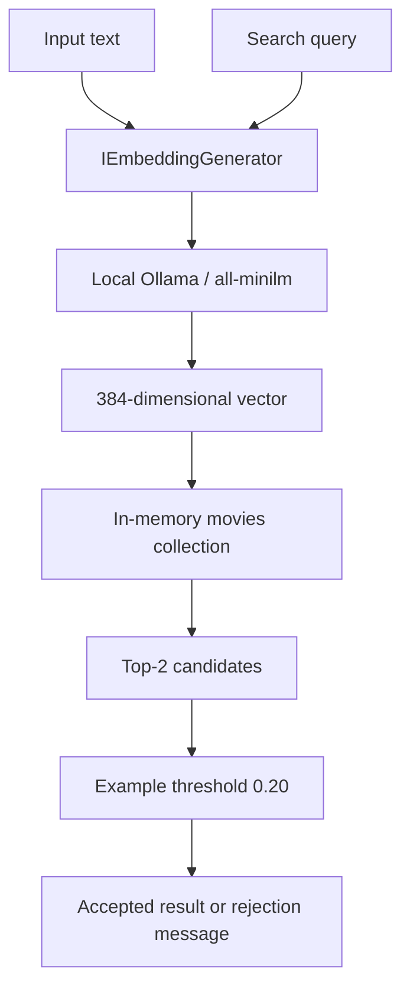

# Portfolio review guide

This repository contains small, executable .NET learning examples. It is the current AI learning project, not a production customer system.

## Suggested review path

| Time | Read | What it demonstrates |
|---|---|---|
| Start here | [README](../README.md) | Scope, setup, and project status |
| Chat | [TextCompletion/Program.cs](../TextCompletion/Program.cs) | IChatClient, streaming, and in-memory conversation history |
| Backend tools | [ProductStock/Program.cs](../ProductStock/Program.cs) | A model requesting a C# stock lookup with simulated data |
| Tool diagnostics | [FunctionCall/Program.cs](../FunctionCall/Program.cs) | Model capability checks, tool invocation logging, and unit validation |
| Retrieval | [VectorSearch/Program.cs](../section6_vectors/VectorSearch/Program.cs) | Indexing, Top-K retrieval, and a learning-only threshold |
| Vector schema | [Movie.cs](../section6_vectors/VectorSearch/Movie.cs) | Stored metadata and a 384-dimensional cosine vector property |

## Application boundaries

The diagram summarizes the sample flow. The same generator creates document and query vectors. The store does not call a chat model or generate an answer. It is not Qdrant or RAG.

## Contribution and evidence

These examples were implemented and adapted while following a course, with local Ollama replacing the course's provider path. `ProductStock` is an additional exercise applying the function-calling concept. The walkthroughs record observed limitations, including generated text that fails instructions and model-dependent tool behavior.

There are no benchmark claims or automated quality scores. A successful build checks compilation, not model correctness. Weather and inventory are simulated; vector-store data is lost when the process exits.

## Verification

On 2026-10-27, `dotnet build Solution1.slnx --no-restore` completed with **0 warnings and 0 errors** in the prepared environment. Runtime examples were exercised during the learning sessions; their exact results depend on local models and are not continuous integration guarantees.

No application behavior, dependencies, license, or ownership declarations were changed by this documentation update.
